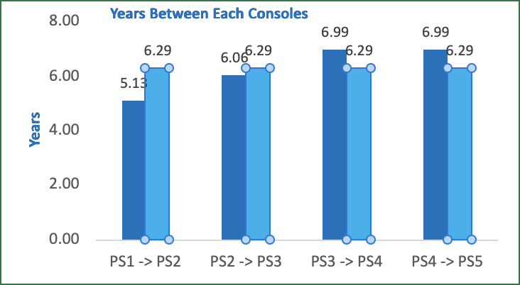
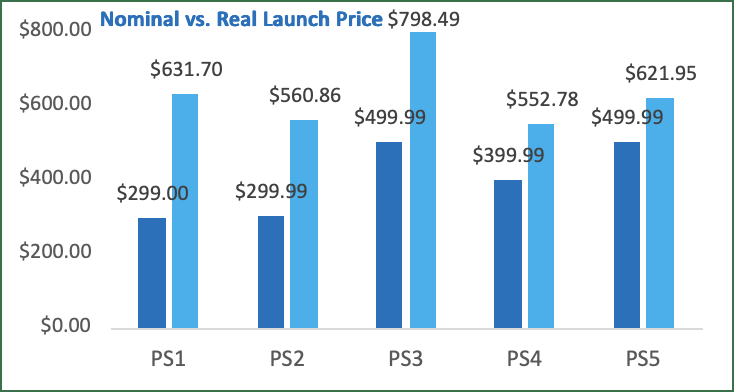
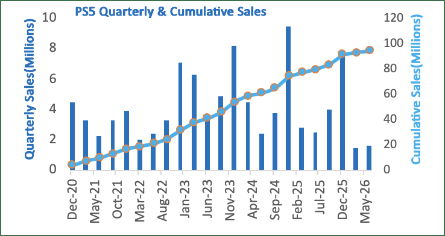
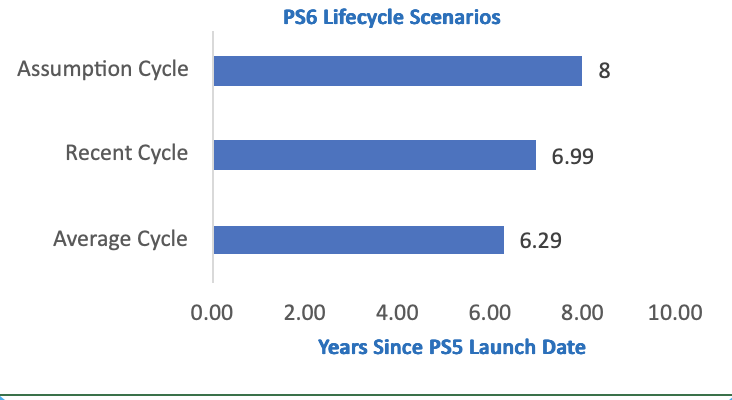

# PlayStation Lifecycle Analysis

### Analyzing PlayStation console lifecycles, inflation-adjusted pricing, PS5 hardware performance, and PS6 scenario benchmarks using Excel, Python, and SQL.

---

## Project Overview

Sony's PlayStation platform has evolved through multiple console generations since the launch of the original PlayStation in the 1990s. Each generation has differed in lifecycle length, launch pricing, and hardware performance. This project analyzes historical PlayStation console cycles, inflation-adjusted launch prices, and PS5 quarterly hardware performance to better understand how the PlayStation platform has evolved over time.

### Research Questions

1. How have PlayStation console lifecycle lengths changed across generations?
2. How have PlayStation launch prices changed after accounting for inflation?
3. How has PS5 quarterly hardware performance changed throughout its lifecycle?
4. What seasonal patterns appear in PS5 hardware shipments?
5. What historical PS6 timing benchmarks can be constructed from previous PlayStation generations?

> **Note:** The PS6 scenarios in this project are historical benchmarks, not predictions or forecasts of Sony's actual product plans.

---

## Tools Used

- **Microsoft Excel**: Historical analysis, PivotTables, PivotCharts, KPIs, slicers, dashboard design, and scenario analysis
- **Python**: Data cleaning, CPI processing, inflation adjustment, and visualization
- **Pandas**: Data manipulation and analysis
- **Matplotlib**: Python data visualization
- **MySQL**: Quarterly hardware analysis, aggregations, window functions, QoQ/YoY analysis, and reporting views
- **Jupyter Notebook**: Python analysis documentation

---

## Final Dashboard

()


The final Excel dashboard combines:

- Historical PlayStation lifecycle analysis
- Inflation-adjusted launch-price analysis
- PS5 quarterly hardware shipments
- Cumulative PS5 hardware shipments
- Year-over-year growth
- Holiday seasonality
- PS6 lifecycle scenarios

### Project Files

- [Final Excel Dashboard](excel/PlayStation_Lifecycle_Analysis_Final.xlsx)
- [Python Inflation Analysis](python/playstation_inflation_analysis.ipynb)
- [Database Setup](sql/01_database_setup.sql)
- [PS5 SQL Analysis](sql/02_ps5_sales_analysis.sql)
- [Final SQL Analysis](sql/03_ps5_final_analysis.sql)
- [PS5 Quarterly Dataset](data/ps5_quarterly_sales.csv)
- [Sources & Methodology](sources/sources.md)

---

## Data Structure

The project combines three primary analytical datasets.

| Dataset | Level of Analysis | Primary Use |
|---|---|---|
| Console History | One row per PlayStation generation | Release dates, lifecycle lengths, launch prices, and historical hardware sales |
| Console Pricing | One row per PlayStation generation | CPI and inflation-adjusted launch prices |
| PS5 Quarterly Hardware | One row per fiscal quarter | Shipments, cumulative shipments, QoQ growth, YoY growth, and seasonality |

---

## Analytical Workflow

The project follows an end-to-end analytical workflow:

**Excel → Python → MySQL → Advanced Excel Dashboard**

### Excel

Excel was used to establish the historical PlayStation dataset, calculate generation intervals, and perform the initial exploratory analysis.

### Python

Python was used to process Consumer Price Index data and convert historical PlayStation launch prices into constant 2025 dollars.

### MySQL

MySQL was used to analyze PS5 quarterly hardware performance, including:

- Quarterly shipments
- Annual shipments
- Cumulative shipments
- Quarter-over-quarter growth
- Year-over-year growth
- Fiscal-quarter seasonality
- Performance categories

### Advanced Excel

The final analytical outputs were combined into an interactive Excel dashboard using:

- KPI cards
- PivotTables
- PivotCharts
- Slicers
- Scenario analysis
- Dashboard navigation

---

# Executive Summary

The analysis identified several patterns across PlayStation's historical console cycles, pricing, and PS5 hardware performance.

### 1. Console Lifecycles Have Lengthened

The average completed PlayStation generation interval is approximately **6.29 years**.

The PS3 → PS4 and PS4 → PS5 transitions were both approximately **6.99 years**, showing that recent PlayStation generations have lasted longer than some earlier generations.

### 2. Inflation Changes the Pricing Story

After adjusting selected U.S. launch prices into 2025 dollars, the analysis shows that nominal price alone does not accurately represent how expensive each console was relative to its time.

The PS3 configuration analyzed in this project had the highest inflation-adjusted price at approximately **$798**, while the PS4 had the lowest at approximately **$553**.

The PS5's approximately **$622** real launch price is also close to the original PlayStation's approximately **$632** inflation-adjusted launch price.

### 3. PS5 Shows Strong Holiday Seasonality

PS5 hardware data demonstrates substantial fiscal Q3 seasonality.

Fiscal Q3 contains the October–December holiday period and repeatedly produced some of the strongest hardware shipment results in the dataset.

### 4. PS5 Hardware Performance Has Moderated

PS5 hardware shipments expanded substantially during the earlier portion of the lifecycle before moderating in later completed fiscal years.

This pattern is consistent with a console progressing into a more mature lifecycle stage.

### 5. Historical PS6 Scenarios Center Around 2027–2028

Historical generation intervals produce PS6 scenario benchmarks ranging approximately from **2027 to 2028**.

These scenarios provide historical context only and are **not predictions of Sony's actual PS6 release date**.

---

# Insights Deep Dive

## 1. PlayStation Console Lifecycle

The average completed PlayStation generation interval is approximately **6.29 years**.

The two most recent completed transitions were approximately:

- PS3 → PS4: **6.99 years**
- PS4 → PS5: **6.99 years**

This suggests that recent PlayStation generations have remained active longer before the launch of their successors.



### Why It Matters

The historical average provides a useful benchmark, but the two most recent completed generations suggest that recent PlayStation hardware cycles have been closer to seven years.

---

## 2. Inflation-Adjusted Launch Prices

Historical console prices were converted into constant **2025 U.S. dollars** using CPI-U data from the U.S. Bureau of Labor Statistics.

The formula used was:

**Real Price (2025 USD) = Nominal Launch Price × (2025 CPI / Launch-Year CPI)**

Selected results include:

| Console | Nominal Launch Price | Real Price in 2025 USD |
|---|---:|---:|
| PS1 | $299.00 | ~$631.70 |
| PS2 | $299.99 | ~$560.86 |
| PS3* | $499.99 | ~$798.49 |
| PS4 | $399.99 | ~$552.78 |
| PS5 | $499.99 | ~$621.95 |

\*PS3 launched with multiple configurations. The project uses a selected launch configuration for consistency and documents this assumption in the source methodology.



### Why It Matters

A higher nominal launch price does not necessarily mean a console was historically more expensive.

Inflation adjustment provides a more meaningful comparison between consoles released decades apart.

---

## 3. PS5 Hardware Performance

The SQL analysis evaluates quarterly PS5 hardware sell-in throughout the console's lifecycle.

The strongest individual quarterly observation in the project dataset was approximately **9.5 million units**.



The analysis also calculates:

- Quarterly hardware shipments
- Cumulative hardware shipments
- QoQ growth
- YoY growth
- Annual totals
- Fiscal-quarter seasonality

### Why It Matters

The combination of earlier hardware expansion and subsequent moderation is consistent with PS5 progressing into a more mature lifecycle stage.

However, hardware shipment trends alone cannot determine when Sony will introduce another console generation.

---

## 4. Holiday Seasonality

PS5 hardware performance demonstrates substantial seasonality.

Fiscal Q3 includes the October–December holiday shopping period and repeatedly produces strong hardware shipment results.

The highest quarterly observation in the project dataset — approximately **9.5 million units** — occurred during fiscal Q3.

### Why It Matters

Sequential quarter-over-quarter comparisons can be misleading when strong seasonal patterns exist.

Year-over-year comparisons between equivalent fiscal quarters provide additional context when evaluating hardware momentum.

---

# PS6 Scenario Analysis

Historical PlayStation generation intervals were used to construct three PS6 lifecycle scenarios.

| Scenario | Lifecycle Length | Approximate Benchmark | Basis |
|---|---:|---|---|
| Historical Average | 6.29 years | Early 2027 | Average of completed historical cycles |
| Recent Cycle | 6.99 years | Late 2027 | Recent PS3→PS4 and PS4→PS5 cycles |
| Extended Cycle | 8.00 years | Late 2028 | Analyst-created extended lifecycle assumption |



### Interpretation

The historical-average scenario produces a benchmark around early 2027.

The two most recent completed PlayStation cycles were approximately seven years, producing a recent-cycle benchmark around late 2027.

The extended scenario evaluates what the timeline would look like if the PS5 generation lasted eight years.

> **Important:** These scenarios are historical benchmarks for analytical comparison. They are not forecasts, leaks, Sony guidance, or predictions of the PS6 release date.

---

# Analytical Implications

### Lifecycle

Recent PlayStation generations have lasted approximately seven years, making recent-generation intervals useful alongside the full historical average when evaluating PS5's lifecycle.

### Pricing

Console pricing should be evaluated using both nominal and inflation-adjusted dollars. A higher sticker price does not necessarily mean a console was historically more expensive.

### Seasonality

Fiscal Q3 holiday performance should be considered when interpreting PS5 hardware momentum. Comparing equivalent fiscal quarters can provide better context than relying only on sequential quarterly changes.

### PS5 Lifecycle

Moderating hardware shipments may be consistent with lifecycle maturation but should not be interpreted as direct evidence of an upcoming PS6 launch.

### PS6 Scenarios

Historical lifecycle intervals provide useful scenario benchmarks, but they cannot determine Sony's actual hardware strategy.

---

# Caveats & Assumptions

- Only four completed main-generation PlayStation transitions are available for lifecycle analysis.
- The historical sample is therefore too small to support a credible statistical prediction of a PS6 release date.
- PS6 dates shown in the project are scenario benchmarks rather than forecasts.
- The eight-year lifecycle scenario is an analyst-created assumption.
- Inflation-adjusted prices use CPI-U and are expressed in constant 2025 dollars.
- CPI measures the general consumer price level and does not account for improvements in console technology or product quality.
- Several PlayStation generations launched with multiple configurations, so selected U.S. launch configurations are used for historical price comparisons.
- PS5 is an active platform, so its current cumulative hardware figure should not be interpreted as completed lifetime sales.
- Sony's quarterly hardware figures are rounded, which can create small differences between calculated quarterly sums and separately reported annual totals.
- Sony's fiscal year runs from April through March.
- Hardware shipment trends alone cannot forecast future PlayStation hardware releases.

---

# Technical Skills Demonstrated

## Excel

- Data cleaning
- Excel Tables
- Formulas
- XLOOKUP
- KPI calculations
- PivotTables
- PivotCharts
- Slicers
- Dashboard development
- Scenario analysis

## Python

- pandas
- Data cleaning
- Data transformation
- Dataset merging
- CPI analysis
- Inflation adjustment
- Percentage-change calculations
- Exploratory data analysis
- Matplotlib visualization

## MySQL

- Database creation
- Table creation
- Data validation
- GROUP BY
- Aggregate functions
- CASE expressions
- Common Table Expressions
- Window functions
- LAG()
- Cumulative calculations
- QoQ analysis
- YoY analysis
- SQL views
- Reporting queries

---

# Repository Structure

```text
playstation-lifecycle-analysis/
│
├── README.md
│
├── data/
│   └── ps5_quarterly_sales.csv
│
├── excel/
│   └── PlayStation_Lifecycle_Analysis_Final.xlsx
│
├── python/
│   └── playstation_inflation_analysis.ipynb
│
├── sql/
│   ├── 01_database_setup.sql
│   ├── 02_ps5_sales_analysis.sql
│   └── 03_ps5_final_analysis.sql
│
├── images/
│   ├── dashboard_overview.png
│   ├── lifecycle_analysis.png
│   ├── pricing_analysis.png
│   ├── ps5_sales_analysis.png
│   └── ps6_scenarios.png
│
└── sources/
    └── sources.md
